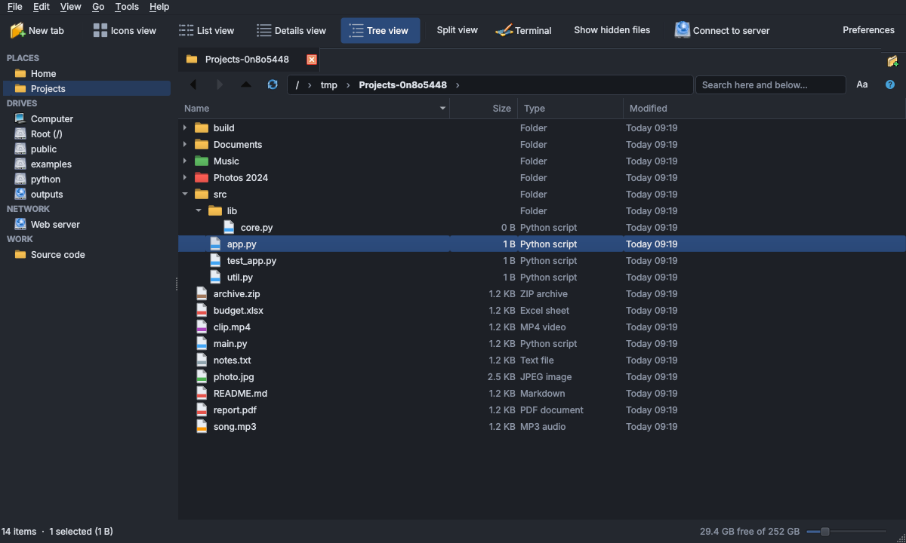

# PyExplorer

A fast, modular, cross-platform file explorer written in Python with Qt (PySide6).



Built around one idea: **every part is a separate, replaceable piece**. Views,
file systems, search, file operations, the terminal and the sidebar each live in
their own module and talk to the rest through a small, documented interface.
New features (say, "multi-layer tabs") are added by writing a new piece, not by
rewriting the backend.

## Installing and running

You need Python 3.9 or newer.

```bash
pip install -r requirements.txt
python main.py              # restores your last session (or opens your home folder)
python main.py ~/Projects   # also opens an extra tab there
```

On Linux, if your distribution's Python complains about "externally managed"
packages, use a virtual environment first:

```bash
python3 -m venv .venv
source .venv/bin/activate        # Windows: .venv\Scripts\activate
pip install -r requirements.txt
```

**Required:** `PySide6` (the interface) and `pyte` (the terminal).
**Optional:** `smbprotocol` for SMB/Samba shares (TrueNAS, Synology, Windows...),
`paramiko` for SFTP, `send2trash` for the most reliable trash, and on Windows
`pywinpty` for a full terminal. Without them everything else still works.

## Features

| | |
|---|---|
| **Views** | Icons, List, Details, **Tree** (expandable folders, like Konqueror/Dolphin). The view mode is **global**: switching changes every tab. Right-click the column header to choose columns. |
| **Zoom** | Ctrl + mouse wheel, Ctrl +/−/0, or the status-bar slider. Each view mode remembers its own size. Image thumbnails appear in Icons view. |
| **Speed** | Listings, search and the filter run off the UI thread and *stream* results in. Qt's views only draw what is on screen, so 100,000-file folders and slow network shares don't freeze the window (measured worst pause ≈ 0.1–0.2 s while 100k files stream in). |
| **Tabs** | Ctrl+T / Ctrl+W / Ctrl+Shift+T (reopen). Middle-click a folder to open it in a new tab. Drag tabs to reorder. Drag a tab down and drop it on the other panel's tab bar to move it there. |
| **Split view (F3)** | Commander-style two panels. The current tab moves to the right. New tabs open on the side they were opened from. Shift+F5 / Shift+F6 copy / move to the other panel. F6 switches panel. |
| **Terminal (F4)** | Your real shell (bash/zsh/fish; cmd/PowerShell on Windows with `pywinpty`) in a dock at the bottom, with colours and scroll-back. It `cd`s as you navigate. Ctrl+Shift+C / Ctrl+Shift+V copy/paste. |
| **Sidebar** | Entirely user-defined categories. Add any folder, drive or network location to any category. Rename, reorder and delete categories. Drag items between them. Drag folders in from a view (or another app). F9 toggles it. **Cloud, Drives and Network are live**: they show what is synced, plugged in or mounted *right now*. See [Drives, mounts and cloud storage](#drives-mounts-and-cloud-storage). |
| **Search (Ctrl+F)** | A **Search tab**: one or many folders/drives/shares, or the whole computer. Searches names as you type, Voidtools-Everything style, from an index: milliseconds over millions of files. Also text **inside** files, size, date, type, extensions, hidden files and excluded folders. Results are a normal file list: open, drag, copy, delete, rename. See [Search tab](#the-search-tab-ctrlf). |
| **Rename (Ctrl+F2)** | A **Rename tab** in the spirit of Bulk Rename Utility: Replace, Case, Remove, Move/Copy, Add, Numbering and Extension rules, with **Before / After** columns, conflict checks, safe renaming (swaps and chains) and Undo. F2 with several items selected opens it too. See [Rename tab](#the-rename-tab-ctrlf2). |
| **Transfers (Ctrl+J)** | PyExplorer's own copy/move, in the spirit of TeraCopy. **Verifies every file** by default, keeps going when a file fails, stops only if the drive fills up, and **won't start a transfer that wouldn't fit**. Per-file ✓/✗ list, speed plot, and a list of past transfers. Shows in a window or a tab whose tab is shaded with the progress, plus progress on the taskbar. See [Transfers](#transfers-ctrlj). |
| **History (Ctrl+H)** | A **History tab** listing what you did to files: renames (also from the Rename tab), moves, copies, new folders/files, trash and permanent deletes. Undo a whole action or single files, newest first. Deletes are listed but can't be undone. See [History tab](#the-history-tab-ctrlh). |
| **Instant filter** | Just start typing in a folder (or Ctrl+I). |
| **Address bar** | Clickable breadcrumbs. Click a `›` for a sub-folder menu. Click empty space or press Ctrl+L to type a path (local paths auto-complete) or `sftp://user@host/path`. Drop files on a crumb to copy them there. |
| **Folder colours** | Right-click a folder → Folder colour (palette or custom). |
| **Cloud files** | OneDrive, Dropbox, Google Drive and iCloud folders are detected automatically. Each file gets a small badge showing the sync app's own icon, taken from the installed program: **greyed out + faded file** = cloud only, **full colour** = on this device, **full colour + dot** = always kept on this device. The tooltip and an optional **Status** column (right-click the column header) say it in words. On Windows, right-click → *Always keep on this device* / *Free up space*. Thumbnails and checksums never download cloud-only files by accident. *Show in system file manager* opens Explorer/Finder for OneDrive extras like Share or Version history. See [Cloud files](#cloud-files) below. |
| **Network** | **SMB/Samba** (TrueNAS, Synology, QNAP, Windows PCs), SFTP, FTP and FTPS, saved like WinSCP's site manager (Connect… button), or just typed in the address bar. Copy, paste, drag, search and the filter work like on any other folder. Shares already mounted by your system (Nemo/GVFS, `/etc/fstab`, `mount`, rclone) show up by themselves under Computer and in the sidebar's Network section. See [Network shares](#network-shares-smb--truenas). |
| **Files** | Copy/cut/paste **shared with other file managers** (Explorer, Finder, Dolphin, Nautilus), drag & drop **to and from other apps**, inline rename (F2), trash (Del) / permanent delete (Shift+Del), new folder/file, conflict dialog (replace / skip / keep both), progress + cancel in the status bar, properties with folder size and SHA-256. |
| **Session** | Tabs (including Search, Rename and History tabs with their settings), panels, split, per-tab history, scroll position, selection, expanded tree folders, window/dock layout and terminal state are all restored on the next start, and autosaved every 20 s. |
| **Other** | Back/forward/up (also mouse back/forward buttons), show hidden (Ctrl+Shift+H or Alt+.), sort by name/size/type/date with folders first, auto-refresh when folders change on disk, **50 colour themes** (see [Themes](#themes)), a "Computer" view of drives + connections, a preferences dialog, and an **editable keyboard-shortcuts dialog (F1)**. |

### Name search syntax

| Query | Meaning |
|---|---|
| `holiday photo` | name contains both words |
| `jpg\|png` | either word |
| `!thumb` | name must *not* contain it |
| `"two words"` | exact phrase |
| `*.py`, `IMG_????.jpg` | wildcards (match the whole name) |
| `ext:jpg;png` | by extension |
| `file:` / `folder:` | only files / only folders |
| `size:>10mb`, `size:1mb..50mb` | by size |
| `dm:today`, `dm:7d`, `dm:>2024-01-31` | by date modified |
| `path:music` | match the full path |
| `regex:^IMG_\d+` | regular expression |

The same syntax works in the Search tab's Name box and in the instant filter (type in a
folder). `Aa` makes it case-sensitive, and the `?` button lists the syntax (click an
entry to insert it).

## Utility tabs

Search and Rename open as **utility tabs**: they sit in the tab bar beside folder tabs,
can be moved between the split panels, are saved with the session and reopen with
Ctrl+Shift+T. They look different on purpose: an accent-tinted tab with a coloured stripe
on its left edge, and a tinted header band across the top.

### The Search tab (Ctrl+F)

Ctrl+F (or the magnifier in the address bar, or right-click a folder → *Search in this
folder…*) opens a Search tab for the current folder. Ctrl+F in the *Computer* view
searches the whole computer.

- **Look in:** any number of folders, drives, network shares or cloud folders
  (*+ Folder…*, *+ Drive*), or tick **Whole computer**: every local drive, plus network
  drives if you allow it in *Preferences → Search*.
- **Name:** searched **as you type**, using the syntax above.
- **Contains:** text inside the files. Press Enter to run it; *Aa* matches case, *.\**
  makes it a regular expression, *W* matches whole words only. Results get a
  *Matching line* column with the matched text in ***bold italic***. Binary files are skipped.
- **Filters:** files and/or folders, extensions, size (at least / at most / between),
  date modified (today, last 7/30 days, last year, before / after / between dates),
  hidden files, and folders to skip (e.g. `node_modules, .git`).
- **Results** use the normal views (Details, List, Icons, Tree), so you can open, drag,
  copy, delete, use Open With and right-click as usual. *Open containing folder* opens a
  folder tab with the file selected. Select several and press F2 to bulk-rename them.

**How it's so fast:** the first search of a place reads it once and builds an **index**
of every name, size and date. All the names are stored in *one* long string, so a name
search is a single C-speed scan rather than a Python loop over millions of files. This
is the same idea that makes Voidtools' Everything fast. Measured on a test machine with
2.5 million files:

| | |
|---|---|
| Building the whole-computer index (first time only) | ~23 s, in the background |
| Loading it at the next start | ~0.5 s |
| A typical name search (`invoice`, `*.pdf`, `report 2024`) | 30–70 ms |
| Common words / filters (`python`, `ext:jpg;png`, "over 100 MB") | 0.1–0.4 s |

**Keeping it current:** the index is saved in `~/.cache/pyexplorer/index`. Changes made
by PyExplorer, and changes in folders open in a tab, are patched in within about 2
seconds. Anything else is caught by a background re-read when the index is older than
*Preferences → Search → Re-read after (minutes)* (default 30). Searches still answer
instantly from the old index in the meantime, and open Search tabs refresh by themselves
when the new one is ready. *Tools → Update search index* (or the button in the tab)
re-reads now. Network folders are indexed too, but only for the session.

### The Rename tab (Ctrl+F2)

Ctrl+F2 opens it for the current folder, with the selected items ticked if there are any.
F2 with **several** items selected, or right-click → *Bulk rename*, opens it for exactly
those items, including search results from many folders.

The list shows **Current name** and **New name** side by side, updating as you type.
New names are highlighted; a name that can't be used is shown in red (point at it to see why).
The rules panel opens exactly as tall as its contents; drag the divider to change that. Untick rows to
leave them alone (Space toggles the selected rows; *Tick: All / None / Invert / Selected*).
In folder mode you can show files and/or folders, filter by pattern (`*.jpg;*.png`) and
include subfolders.

The rules work on the name **without** its extension and apply in this order:

| Rule | What it does |
|---|---|
| **Case & Name** | Name: keep / remove / replace with fixed text / reverse. Case: lower, UPPER, Title, Sentence, iNVERT |
| **Replace** | Find → replace (optionally case-sensitive, or a regular expression with `\1` groups) |
| **Remove** | first N, last N, characters From–To, crop before/after a text, given characters, digits, trim ends, double spaces |
| **Move / Copy** | move or copy the first/last N characters to the start, end or a position, with a separator |
| **Add** | prefix, insert at a position, suffix, spaces between words (`HolidayPhoto` → `Holiday Photo`) |
| **Numbering** | prefix / suffix / insert; start, step, minimum digits (`001`), separator |
| **Extension** | same, lower, UPPER, Title, remove, new, add an extra one (`.tar` → `.tar.gz`) |

Positions count from 1, and negative positions count from the end.

**Safety:** nothing is renamed until you press *Rename N items*. Two items can't end up with
the same name, an existing file is never overwritten, and invalid names are refused (`/`,
plus `<>:"\|?*` and reserved names on Windows). Swaps and chains (a → b while b → c)
and case-only changes are done safely via temporary names. If one rename fails, the others
still happen and that file keeps its old name. **Undo last rename** puts everything back.

### Transfers (Ctrl+J)

Every paste, drag-and-drop and *copy/move to other panel* goes through PyExplorer's own
transfer engine and opens the **transfer window**. Ctrl+J or *Tools → Transfers…* opens it at any time.
PyExplorer can't replace copies made by *other* programs.

- **Verified by default.** Each file is checksummed while it's copied, then the copy is read
  back and checked against it. On local drives the copy is flushed to disk and dropped from the
  OS cache first, so the check reads the disk rather than memory. The default checksum is BLAKE2b; xxHash3,
  MD5, SHA-1 and SHA-256 are in Preferences. Verification can be turned off there.
- **One bad file doesn't stop the rest.** It gets a red ✗ with the reason, and the next one starts.
  A folder with failures inside gets a ✗ too, saying how many failed. Only a **full drive**
  stops a transfer, and then the files not reached are marked *not copied*.
- **Space is checked first.** A transfer that would fill the destination drive doesn't start at
  all. You're told how much it needs and how much is free.
- **Moves are safe.** An original is deleted only after its copy is verified. A move within one drive is
  a rename, which is instant. Emptied source folders are removed. Half-written files are never left behind.
- **What you see:** a big progress bar, the current file, current and average speed, time left,
  ✓/✗ counts, a **speed plot**, Pause/Resume/Cancel, and the file list with a ✓ or ✗ per file.
  *Show: Problems* lists just what needs attention. The file list can be hidden with the *Files* checkbox.
  Double-click a file to open its folder.
- **A transfer log.** A new copy never wipes the earlier ones. Every transfer stays listed with its
  date and time, number of files, size, average speed and result, until you press *Clear finished*.
  The list is kept between sessions in `transfers.json`. Full file lists are saved for the newest
  transfers, up to 50,000 rows. Failed and not-copied files are always saved.
- **Window or tab.** The window is the default, and it **stays open when done** (both changeable
  under *Preferences → Transfers*). *Open as tab* moves it into the main window as a
  Transfers tab, **shaded like a progress bar** while copying. *Open in a window* moves it back.
  A transfer that starts shows the window or tab without taking the keyboard focus.
- **Taskbar progress**, in window or tab mode: Windows (the taskbar button), KDE Plasma /
  GNOME docks / Plank through the Unity launcher API (needs PyExplorer installed with a
  `pyexplorer.desktop` file), and Cinnamon / MATE / Xfce through the XApp window hint.
- Quitting while something is copying asks first.
- *Preferences → Transfers → Copy and move with: Simple copier* switches back to the older copier,
  which shows only status-bar progress and doesn't verify.

### The History tab (Ctrl+H)

Ctrl+H (or *Tools → History…*) opens the History tab. If it's already open, Ctrl+H goes to it.
Each row is one action, with the newest at the top. Expand an action to see every file in it.
*Show* narrows the list to one kind of action, or to what can still be undone. *Find* matches any part of a path.

| Action | Undo does |
|---|---|
| **Renamed** (F2, or the Rename tab) | renames back. Swaps and chains are handled safely |
| **Moved** (cut/paste, drag, Shift+F6) | moves back to the original folder and name, across drives and servers too |
| **Copied** | removes the copies (to the trash where there is one). The originals are not touched |
| **Created** (new folder / new file) | removes it, but only while it is still empty |
| **Moved to trash / Deleted permanently** | can't be undone. These are listed only |

Select actions or single files and press **Undo** (or Ctrl+Z in the list, or right-click).
Several actions are undone newest first, because a later step may depend on an earlier one.
**Undo never overwrites anything.** If something is already back at the old name, or the item has moved
on since, that file is skipped with the reason in the status bar. You can retry once the
way is clear. Two cases can't be undone and say so in the *Status* column:

- a folder moved or copied **into an existing folder** of the same name. Taking it back would take the folder's old contents too.
- a **copy that replaced** an existing file, because the replaced file is gone.

Double-click a file (or right-click → *Open containing folder*) to go to where it is now.

**Kept between sessions** in `history.json` next to `settings.json`, for 30 days. To keep the file small,
it saves the newest actions up to a budget of 20,000 file paths, which is a few MB at most. A
single bigger action (say, a 50,000-file bulk rename) is kept for the current session only,
and is marked *this session only*. Untick **Keep after closing** to have the history forgotten
when PyExplorer closes. *Clear history* empties the list. It never touches your files.

## Themes

*View → Theme* (or *Preferences → Appearance*) offers **System** (your desktop's own look)
plus 50 colour themes in *Dark* and *Light* groups. Most are modelled on popular VS Code
themes: Dark Modern, Dark+, One Dark Pro, Dracula, Monokai (+ Pro), GitHub (Dark, Dimmed,
Light), Tokyo Night (Night, Storm, Light), Catppuccin (Mocha, Macchiato, Frappé, Latte),
Night Owl (+ Light), Gruvbox, Ayu (Dark, Mirage, Light), Material (Ocean, Palenight),
Cobalt2, Shades of Purple, SynthWave '84, Rosé Pine (+ Moon, Dawn), Everforest, Kanagawa,
Horizon, Andromeda, Poimandres, Moonlight, Panda, Oceanic Next, Vitesse, Nord, Solarized,
Quiet Light, One Light, Light Modern…

**Fonts:** *Preferences → Appearance* has a **Font** picker listing every font installed
on your computer, each shown in its own typeface. It changes the font of the whole
interface: menus, sidebar, tabs, file views, dialogs and status bar. The terminal has its
own **Terminal font** picker, which lists only monospace fonts, since a terminal needs
equal-width letters. *Font size* applies to both. "System default" follows your desktop's
font settings.

Every theme is drawn the same way, VS Code style:
- the sidebar, toolbar and tab strip share one colour; the current tab, address bar and
  file list share another, so the open folder reads as one sheet;
- areas are separated by 1-pixel lines, and the current tab of the active panel gets an
  accent line along its top;
- the back/forward/up/refresh icons are drawn in the theme's own colours, so they stay
  readable even when your desktop's icon set is meant for the opposite light/dark mode;
- the terminal uses the theme's own 16 colours.

Each theme is a dozen key colours in `ui/themes.py`. The rest (borders, hover, row striping,
inputs, scroll bars, terminal colours) is derived by the same rules for every theme. Those
rules also check WCAG contrast: text must be readable and lines and selections visible. A
colour that falls short is nudged just enough to pass, so every theme keeps its character.

## Drives, mounts and cloud storage

Plug in a USB stick, run `rclone mount`, open a share in Nemo or start a sync app, and it
appears in the sidebar and the Computer view straight away. It disappears again when
it's removed. The status bar says what was connected or removed.

| Sidebar section | What appears there |
|---|---|
| **Cloud** | rclone mounts of cloud remotes (OneDrive, Google Drive, Dropbox, pCloud, MEGA, Proton Drive, S3…), onedriver, pCloud Drive, Google Drive from GNOME Online Accounts, and the folders of sync apps: the `onedrive` client, Dropbox, Nextcloud/ownCloud, Insync, MEGA. On Windows/macOS: every registered sync app. Hidden when there is none. |
| **Drives** | Disks and partitions, USB sticks and SD cards, DVDs, phones and cameras (MTP), and other mounts in `/mnt` or your home folder (mergerfs, gocryptfs…). |
| **Network** | Your saved connections, plus SMB/NFS/SSHFS mounts, rclone mounts of SFTP/SMB/FTP/WebDAV remotes, shares opened in Nemo, and `/etc/fstab` shares (greyed "not mounted" until opened). |

**How full is it?** Every drive in the sidebar and in the Computer view has a bar behind its
name in the theme's accent colour. The bar is stronger above 90% full. Point at the drive to see
"X free of Y". The Computer view's Size column shows the free space. Turn the bars off under
*View → Drive usage bars*. The numbers are measured in the background, so a slow or stuck network
share never holds up the window.

| Kind of drive | Where the numbers come from |
|---|---|
| Disks, USB sticks, SMB/NFS/SSHFS mounts, shares opened in Nemo (GVFS) | the drive or share itself, refreshed every 20 s while shown and after file operations |
| rclone mounts (OneDrive, Google Drive, Dropbox…) | the cloud account's quota, which rclone reports for the mount. If a backend has no quota, `rclone about` is asked instead |
| Sync app folders (OneDrive, Dropbox, Google Drive, MEGA apps, on any OS) | `rclone about <remote>:` when `rclone.conf` has a remote for the same service, refreshed every 10 min. With two accounts of one service, the remote's name must appear in the folder's label. **No matching remote = no bar.** The local disk's numbers would be wrong for a cloud folder |
| `/etc/fstab` shares that aren't mounted, SFTP/FTP connections | not measured. Nothing is mounted or connected just for a bar |

- **rclone:** PyExplorer reads your `rclone.conf` to see what each remote really is, so
  `rclone mount onedrive: ~/OneDrive` shows under Cloud with OneDrive's name. It also
  looks through `crypt`, `alias` and `union` remotes. If your rclone config is
  encrypted, it guesses from the remote's name ("gdrive", "onedrive"…).
- **Sync apps** that aren't running are shown greyed out. The tooltip says so.
- **Right-click** a live entry → *Hide from sidebar*, or *Keep a shortcut in* another
  category (so it stays when unplugged). Dragging it into a category does the same.
  Right-click the section → *Show hidden entries again*. A deleted live section can be
  brought back with right-click → *Add live section*.
- **How it notices:** on Linux, the kernel announces every mount and unmount, so mounts show
  up instantly and an idle PyExplorer does no work. GVFS shares and sync apps are checked
  every 2 seconds (each check takes under a millisecond). The checks never touch
  the mounted folders themselves, so a NAS that has gone offline can't freeze anything.

Your existing sidebar is upgraded once: the copy of your drives made on first run is
replaced by the live list. Your own shortcuts stay where they were.

## Network shares (SMB / TrueNAS)

PyExplorer talks SMB 2/3 itself, so nothing has to be mounted first and it works the
same on Linux, Windows and macOS.

- **Quick:** type `smb://truenas.local/` (or the NAS's IP address) in the address bar.
  You are asked for your NAS username and password, and its shares appear as folders.
  `\\truenas\media` typed Windows-style also works, even on Linux.
- **Saved:** click **Connect…**, choose `smb`, enter the host, user and (optionally) a
  share as the start folder, e.g. `/media`. It's added to the sidebar's Network category.
- **Already mounted shares:** shares you opened in Nemo/Nautilus (GVFS), mounted SMB/NFS
  shares and those in `/etc/fstab` appear by themselves in the sidebar's **Network**
  section and under **Computer**. Opening an `/etc/fstab` share that isn't mounted mounts it automatically, if its
  fstab line has the `user` option. Otherwise PyExplorer tells you how to allow that.

### Remembered logins

Tick **Remember this login** in the password box (it's ticked by default) and you
won't be asked again: next time PyExplorer logs in by itself. This works for SMB,
SFTP and FTP.

- Passwords go into your **system keyring**: GNOME Keyring on Linux Mint (the same
  place Nemo and Firefox keep theirs), Credential Manager on Windows, Keychain on macOS.
  This needs the `keyring` package (`pip install -r requirements.txt`). Without it,
  they go into `credentials.json`, a file only your user account can read. The password
  box says which one is in use.
- A login is saved only once the server has **accepted** it, so a typo is never remembered.
- If the password changes on the NAS, you are simply asked again, and the new one is saved.
- **Forget** a login with *Tools → Saved network logins…*, or right-click the server in
  the sidebar → *Forget saved login*.
- Older versions kept "remembered" passwords as plain text in `connections.json`.
  They are moved into the keyring automatically the first time this version starts.

### Opening files on a share (no downloading first)

Double-clicking a video on your NAS starts mpv (or whatever your default app is)
straight away. The app streams the file and can seek, just like from Nemo. PyExplorer
picks the best way to hand it over:

1. **A real path**, if the share is mounted: by Nemo (GVFS), by `/etc/fstab`, or by
   PyExplorer itself, which mounts it the same way Nemo does (`gio mount`). Works with
   every app, and keeps working after PyExplorer closes. On Windows: `\\server\share\…`.
2. **A private stream address** (`http://127.0.0.1:…/<random>/file.mkv`) for apps that
   accept web addresses (mpv, VLC, Celluloid, browsers…). Also used for SFTP/FTP files.
   Only your own computer can reach it, and it stops when PyExplorer closes.
3. **Download a copy first**, only if neither is possible (or if you choose it in
   *Preferences → Network*).

On Linux, right-click a file → **Open With ▸** lists every installed app for that file
type (your default first), like Nemo.

TrueNAS tips:
- Log in with a TrueNAS user that has **SMB access** enabled (not `root`).
- "Access denied" inside a share comes from the **dataset's ACL** in the TrueNAS web
  UI (Datasets → your dataset → Permissions). The file manager can't override it.
- `truenas.local` names need mDNS (on by default in Linux Mint). Otherwise use the IP address.

## Cloud files

| | Windows 10/11 | macOS | Linux |
|---|---|---|---|
| Detect cloud folders | ✓ every registered sync app (OneDrive personal + work, Dropbox, Google Drive, iCloud…) | ✓ `~/Library/CloudStorage` + iCloud Drive | ✓ rclone, onedriver, `onedrive` client, Dropbox, Nextcloud… (no per-file states) |
| Cloud only / on this device | ✓ | ✓ | — |
| Always kept on this device | ✓ | — (macOS doesn't report it) | — |
| Keep on device / Free up space | ✓ (same as `attrib +P` / `attrib +U`) | — | — |
| App icon in the badge | ✓ read from the installed app | ✓ | plain cloud badge |

The states come free with each folder listing, so this costs no speed. After *Keep* /
*Free up space*, the sync app does the work in the background, and PyExplorer re-checks the
states a few times over the next 30 seconds.

## Where settings live

`%APPDATA%\PyExplorer` (Windows) · `~/Library/Application Support/PyExplorer` (macOS) · `~/.config/pyexplorer` (Linux).
They are all plain JSON: `settings.json`, `categories.json`, `folder_colors.json`, `connections.json`, `session.json`.
`saved_logins.json` lists which servers have a remembered login (no passwords; those are in
the system keyring, or in `credentials.json` if there is no keyring).
Set `PYEXPLORER_CONFIG_DIR` to use another folder (e.g. a portable install).

## How the code is organised

```
main.py                    start here
explorer/
  app.py                   composition root: creates & wires everything (read this second)
  context.py               AppContext: the bag of shared services handed to every widget
  commands.py              every user operation (open, copy, split, zoom...)
  actions.py               action table: id -> label, shortcut, icon, command (become QActions)
  core/                    plain Python, no Qt, unit-testable
    events.py              EventBus (publish/subscribe) + list of event topics
    tasks.py               thread/process pools, cancel tokens, UI-thread dispatcher, jobs
    settings.py            all settings + defaults          storage.py   atomic JSON files
    fileinfo.py            FileEntry (one file/folder)      query.py     search/filter language
    search_spec.py         what a search asks for (locations, name, contents, filters)
    rename_rules.py        the Rename tab's rules + conflict checks (pure functions)
    folder_model.py        sorted + filtered list for a tab sorting.py   natural sort keys
    transfer_model.py      transfers + per-file states + the saved transfer log (no I/O)
    file_history.py        the History tab's record of renames/moves/copies/deletes, saved within a budget
    history.py  categories.py  folder_colors.py  connections.py  session.py  clipboard.py
    cloud.py               cloud file states (cloud only / on device / pinned) from OS attributes
  vfs/                     "virtual file systems"
    base.py                the FileSystem interface every location implements
    local.py  computer.py  sftp.py  ftp.py   registry.py (path -> FileSystem)
    smb.py                 SMB/Samba shares (smb://)     smb_shares.py  lists a server's shares
    automount.py           mounts /etc/fstab network shares when you open them (Linux)
  services/                background work (no Qt)
    scanner.py             streaming folder listing     walker.py   parallel tree walker
    search.py              runs searches: index -> fast name scan -> filters -> contents
    file_index.py          the compact "Everything-style" index (one big name string + arrays)
    index_manager.py       which indexes exist, building, saving, background refresh, patching
    content_search.py      text inside files (memory-mapped regex; chunked for network files)
    bulk_rename.py         safe batch renaming (swaps, chains, case-only) + undo
    transfer_engine.py     PyExplorer's copy/move: plan, space check, copy+checksum, verify, continue on errors
    drive_usage.py         how full each drive is: statvfs, rclone mounts, `rclone about` for cloud folders
    fileops.py             copy/move/delete jobs; records them for the History tab, and undoes them
    watcher.py             auto-refresh                   terminal.py (shell back-ends), platform_ops.py
    cloud_providers.py     finds OneDrive/Dropbox/... folders; keep-on-device / free-up-space
    devices.py             drives, mounts, phones, cloud storage -> Drives / Network / Cloud
    device_monitor.py      notices them coming and going (kernel mount events + light polling)
    rclone_config.py       what kind of storage an rclone remote is (from rclone.conf)
    remote_open.py         how to hand a network file to an app: path, stream or download
    network_paths.py       real paths for network files (GVFS, fstab, UNC); mounting like Nemo
    stream_server.py       private local streaming address with seeking, for media players
    desktop_apps.py        installed Linux apps (.desktop files), defaults, "Open With"
    credential_store.py    remembered logins: system keyring, or a private file as fallback
  ui/                      Qt
    qt_bridge.py           hands background results to the UI thread
    models/file_model.py   ONE Qt model used by all four views
    views/                 base.py (shared behaviour) + details.py, grids.py; registry.py
    tab.py                 one tab (controller)          panel.py / panel_area.py  tabs + split
    tab_container.py       tab bar + "+" button + pages (lines up on every style)
    breadcrumb.py  sidebar.py  terminal_widget.py  terminal_pane.py  statusbar.py
    main_window.py  menubar.py  context_menu.py  dialogs.py  icons.py
    qt_messages.py         Qt's own warnings -> our log; known-harmless ones (desktop portal) hushed
    utility/               utility tabs: base.py (UtilityTab + header), search_tab.py, rename_tab.py, history_tab.py
    transfers/             the transfer window: panel.py, files_model.py, speed_plot.py, window.py, tab.py, controller.py
    taskbar.py             taskbar / dock progress (Windows, Unity launcher API, XApp)
    theme.py               applies a theme + the chosen fonts: Qt palette + style sheet for the window chrome
    font_picker.py         drop-down of installed fonts (all, or monospace only), each shown in its own face
    themes.py              the 50 colour themes as data, + contrast rules (no Qt)
    thumbnails.py  system_clipboard.py
tests/                     python tests/test_core.py · python tests/test_gui.py
```

**The rules that keep it modular**
1. `core/`, `vfs/` and `services/` never import Qt. They could drive a different UI.
2. Widgets don't call each other. They get an `AppContext` and either call
   `ctx.commands.something()` or react to events on `ctx.bus`.
3. Only the UI thread touches widgets. Background code hands results back
   through `ctx.dispatcher.post(...)` (see `ui/qt_bridge.py`).
4. Every file access goes through `ctx.vfs.resolve(path)`, so local
   disks and servers are interchangeable.
5. Views never load files. The tab gives them a finished list through the shared
   `FileModel`, which is why view modes can be swapped instantly.

**How a double-click becomes a folder listing:** view → `tab.on_view_activate`
→ `tab.navigate` → `ctx.scanner.scan` (a worker thread streams batches) →
`tab._on_batch` → `FolderModel.add` (sort + filter) → `FileModel.set_entries` → the
Qt view draws only the visible rows.

### Extending it: recipes

| You want… | Do this |
|---|---|
| A new view mode | Subclass one in `ui/views/` (or combine `ViewBehaviour` with any Qt item view) and add it to `VIEW_TYPES` in `ui/views/registry.py`. It appears in the toolbar and menus, and gets a Ctrl+<number> shortcut automatically. |
| A new location type (WebDAV, S3, zip…) | Implement `vfs/base.FileSystem` and call `ctx.vfs.register_scheme("webdav", YourClass)`. Copy/paste, search and the views work with it automatically. |
| A new command + shortcut | Add a method to `commands.py`, then one `reg.add(...)` line in `actions.register_all`. Add the id to `ui/menubar.py` to show it in a menu. |
| A new setting | Add it to `DEFAULTS` in `core/settings.py` (+ one line in `PREFERENCES` in `ui/dialogs.py` to show it in the dialog). |
| A new theme | Add a spec (about a dozen colours) to `SPECS` in `ui/themes.py`. `tests/test_themes.py` checks its contrast. |
| A new utility tab (e.g. "Compare folders") | Subclass `ui/utility/base.UtilityTab` (build the widgets, `get_state`/`restore`) and add it to `_REGISTRY` in `ui/utility/__init__.py`. The tab bar, styling, session and Ctrl+Shift+T then work for it. |
| A new rename rule | Add fields to `RenameRules` and a step to `new_name` in `core/rename_rules.py`, then a card in `ui/utility/rename_tab.py`. |
| Multi-layer tabs | Only `ui/panel.py` changes. Tabs are self-contained widgets that serialise themselves with `get_state()`, so the session format keeps working. |
| React to something (e.g. "folder opened") | `ctx.bus.subscribe(Topics.ACTIVE_LOCATION_CHANGED, your_function)`. |

## Testing

```bash
python tests/test_core.py          # non-GUI parts
python tests/test_cloud.py         # cloud-file states, with simulated OneDrive attributes
python tests/test_mounts.py        # Linux mount detection, with fake /proc/mounts, fstab, GVFS
python tests/test_smb.py           # SMB against a real server (see the top of the file)
python tests/test_open_remote.py   # streaming, mounting, Open With; plays a video in mpv if installed
python tests/test_saved_logins.py  # remembered logins (keyring + fallback file, migration, SMB)
python tests/test_devices.py       # live drives/mounts/cloud; does real rclone + disk-image mounts
python tests/test_themes.py        # contrast rules for every theme, no Qt warnings; font choices apply everywhere
python tests/test_search.py        # index search == slow reference search (297 combinations), contents, speed
python tests/test_rename.py        # every rename rule, conflict checks, swaps/chains/undo on disk
python tests/test_drive_usage.py   # drive bars: disk / rclone mount / rclone about, cache (rclone faked; --real asks yours)
python tests/test_transfers.py     # transfer engine: verify, failures, full drive, space check, moves, pause, log
python tests/test_history.py       # History: recording, undo of every kind, never overwriting, size budget
python tests/test_gui.py           # the real interface, no screen needed (~70 checks)
python tests/test_gui.py --shots   # ...and save screenshots to tests/screenshots/
```

## Known limitations

- **Tree view on gigantic folders:** Qt's tree has to visit every row, so with
  100,000+ items *in one folder* it pauses for about a second each time the list
  refreshes. Details, Icons and List stay smooth at that size.
- **The Windows terminal** needs `pip install pywinpty` to be a full console.
  Without it, each line you type runs as a separate command.
- **No undo** for file operations yet.
- Tested on Linux. Windows- and macOS-specific code paths (drive list, recycle
  bin, Windows terminal, cloud-folder detection and keep/free-up) are written but not
  tested on those systems. The cloud logic is tested with simulated attributes.
- Servers aren't discovered automatically yet: type the address once or save it with Connect….
- Permissions/ACLs can't be viewed or edited from PyExplorer yet.
- Cloud "syncing" and "sync error" states aren't shown yet: Windows only exposes them
  through a more complex API.
